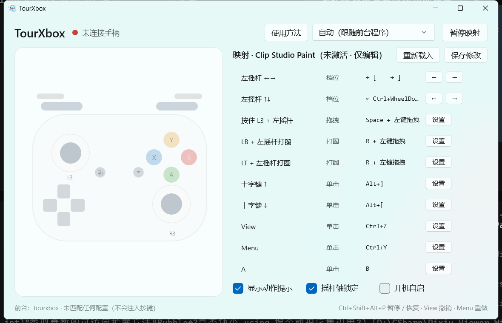

# TourXbox

把 **Xbox 手柄** 变成画画用的 TourBox。

> 不用再花一两千买专用控制器。手柄接上，程序打开，它就是你的左手快捷键台。

  

---

## 它是什么

画图时右手要握笔，左手空着——很多人买 TourBox 就是为了这只手有个"旋钮台"。

TourXbox 让你用手柄做到同样的事：

- **左摇杆当旋钮**：轻推是 1px 级微调，推满是快速扫，画笔大小不用再摸键盘
- **左摇杆打圈 = 转画布**，转多快就转多少，和手的动作同步
- **右摇杆推住 = 画布滚动**，不会把光标带跑
- 撤销重做、切图层、切笔刷、切工具，都在拇指范围里

它**只在你指定的绘图软件位于前台时工作**。切回游戏、浏览器、桌面，它完全不出声——手柄照常当手柄用。

内置 Photoshop、Clip Studio Paint、Krita、PaintTool SAI 的配置，切软件会自动跟着换。

---

## 和 TourBox 比

| | TourBox | TourXbox |
| --- | --- | --- |
| 价格 | 1000～2000 元 | 你已经有手柄的话，0 元 |
| 旋钮 | 3 个实体旋钮 | 2 个摇杆当 4 个旋钮，可连续推 |
| 按键 | 4～8 个 | 11 个 + 十字键 + 扳机 |
| 手感 | 有机械段落 | 靠软件做档位，推得越深越快 |
| 分软件配置 | 支持 | 支持，自动切换 |
| 改键 | 官方工具 | 点一下，按键盘即可 |

它替不掉 TourBox 的段落感——这是模拟摇杆的物理限制。但换来的是：便宜、按键更多、两只手都能用、配置随便改。

---

## 功能

### 调参（左摇杆）

- 画笔大小：左右推，轻推微调、推满快调
- 画布缩放：上下推
- 右摇杆推住即滚动画布，无限且不移动光标

### 画布

- **旋转画布**：按住 LB，左摇杆打圈。转到底会自动无缝续接，不用松手重来
- **平移画布**：右摇杆滚动；或按住 L3 用左摇杆直接拖
- 拖画布时光标被限制在小范围内，松手自动**回到原位**，不用满屏找鼠标

### 图层与工具

- 十字键上下切图层，左右切笔刷预设
- A / B / X / Y 切画笔、橡皮、吸管、新建图层
- 撤销 / 重做绑在 View / Menu 上，拇指一按就到

### 按软件自动切换

内置 4 套配置，识别到对应软件在前台就自动生效；也可以手动固定某一套。

### 提示与托盘

- **动作提示**：屏幕下方弹出"撤销（Ctrl+Z）"，随时知道刚才按了什么
- **托盘常驻**：关掉窗口就收进托盘继续工作
- **一键暂停**：界面按钮、托盘菜单、或全局热键
- 支持开机自启

---

## 下载安装

从 [Releases](https://github.com/TheMyceliumOfAntan/TourXbox/releases) 下载，两种任选：

| 文件 | 说明 |
| --- | --- |
| `TourXbox-<版本>-win-x64.exe` | **推荐**，单文件，双击即用 |
| `TourXbox-<版本>-win-x64.zip` | 目录版，解压后运行，启动更快、体积更小 |

不需要安装 .NET 运行时，不需要管理员权限。

> 单文件版第一次启动会把自己解压到 `%TEMP%\.net\TourXbox`（约 210 MB），所以首次稍慢，之后正常。介意的话用目录版。

### 系统要求

| 项 | 要求 |
| --- | --- |
| 系统 | Windows 10 1809（17763）及以上 / Windows 11 |
| 架构 | x64 |
| 手柄 | Xbox 360 / One / Series 手柄（有线、无线接收器、蓝牙均可） |
| 运行时 | 不需要额外安装 |

首次启动：

1. 程序会缩在托盘里运行，双击托盘图标打开主界面
2. 左上角显示手柄连接状态
3. 打开绘图软件，顶部会自动出现对应的配置名

> 关掉窗口只是收进托盘，映射仍在工作。要彻底退出请右键托盘图标 →「退出」。

---

## 三分钟上手

1. **接上手柄**，程序左上角变成绿点「手柄已连接」
2. **打开 Photoshop / CSP / Krita / SAI**，顶部显示「自动（跟随前台程序）」，并出现对应软件名
3. **左手放到手柄上**，直接画

想先看看每个键是干什么的：点顶部「使用方法」，会按当前软件列出全部功能。

---

## 默认键位

### 基础层

| 操作 | 作用 |
| --- | --- |
| 左摇杆 ← → | 画笔大小 |
| 左摇杆 ↑ ↓ | 画布缩放 |
| 右摇杆 | 画布滚动 |
| 十字键 ↑ / ↓ | 上一 / 下一图层 |
| 十字键 ← / → | 上一 / 下一笔刷预设 |
| View / Menu | 撤销 / 重做 |
| A / B / X / Y | 画笔 / 橡皮 / 吸管 / **水平翻转画布** |
| L3 按住 | 左摇杆变成拖拽平移 |
| R3 | 适合屏幕 |

> 翻转画布是画一会儿就要按一次的操作，所以放在最顺手的 Y 上。
> SAI 和 Krita 开箱即用（分别是 `H` 和 `M`）；Photoshop 需要先指定一次快捷键，见下方「Photoshop 一次性设置」。

### 摇杆特殊操作

| 操作 | 作用 |
| --- | --- |
| LB + 左摇杆打圈 | 旋转画布（可无限续转） |
| L3 + 左摇杆 | 拖拽平移画布 |

### LB 层（按住 LB 不放）

| 操作 | 作用 |
| --- | --- |
| LB + 十字键 ↑ / ↓ | 画布上下滚动 |
| LB + 十字键 ← / → | 笔刷预设 |
| LB + A / B / X / Y | 编组 / 合并 / 取消选择 / 合并可见 |

### RB 层（按住 RB 不放）

| 操作 | 作用 |
| --- | --- |
| RB + 右摇杆 ← → | 画笔大小（粗调） |
| RB + 右摇杆 ↑ ↓ | 画笔硬度 |
| RB + A / B | 显示面板 / 适合屏幕 |
| RB + 十字键 ← / → | 反相 / 翻转（各软件不同） |
| RB + 十字键 ↑ / ↓ | 液化 / 垂直翻转 |
| LB + Y | 新建图层 |

> 不同软件的快捷键略有差异（比如撤销，Photoshop 是 `Ctrl+Shift+Z`，CSP / SAI 是 `Ctrl+Y`），每个软件各有一套配置，互不影响。
>
> 扳机键 LT / RT 默认留空，因为手柄平放在桌上时不太好按——需要的话可以自己绑。

---

## Photoshop 一次性设置（翻转画布）

Photoshop 的「翻转画布」**没有默认快捷键**（Adobe 官方说明：需自行指定），所以第一次用要花 30 秒设一下：

1. 在 PS 里按 `Ctrl+Shift+Alt+K` 打开「键盘快捷键和菜单」
2. 展开「视图」，选中「水平翻转视图」
3. 点它的快捷键栏，按 `Ctrl+Alt+Shift+=`，点「接受」
4. 「垂直翻转视图」同样设成 `Ctrl+Alt+Shift+-`

设完直接按手柄上的 **Y** 就能翻转，不用再动。

液化和反相本来就有默认快捷键（`Ctrl+Shift+X` / `Ctrl+I`），开箱即用。

> SAI 的水平翻转是 `H`、Krita 的镜像画布是 `M`，都是系统默认，不用设置。

---

## 改键

在映射表里点右侧的按钮，然后**直接在键盘上按下想要的键**，确认即可：

- 单击 / 按住类：录一个组合键，例如 `Ctrl+Shift+Z`
- 档位类：`←` 和 `→` 分别录两个方向
- 拖拽 / 打圈类：录修饰键，例如 `Alt+Space`
- 滚轮和鼠标键：在弹窗的下拉里选

改完自动保存，立刻生效，不用重启。

---

## 常见问题

**完全没反应？**

按顺序看三处：左上角是不是绿点（手柄连上没）、右上角是不是「已暂停」、底部前台软件名是不是你的绘图软件。三者都对才会生效。

**打游戏会被干扰吗？**

不会。只有在你打开的绘图软件位于前台时才注入按键，切走就停。

**按了组合键没反应？**

先看底部有没有弹出动作提示：有提示说明按键发出去了，是软件那边没认这个快捷键；没提示说明是配置或手柄的问题。

**光标会跑到画布外面？**

拖拽类操作会把光标限制在起点附近，松手自动归位。如果想让拖拽范围更大，可以在配置里调整。

**全局热键按了没反应？**

`Ctrl+Alt+P` 可能被别的软件占用了，程序会自动换成备用的那个，实际生效的热键显示在界面右下角。

**软件是以管理员身份运行的？**

Windows 不允许普通程序向管理员程序发送按键，这种情况把 TourXbox 也用管理员身份运行即可。

**配置存在哪？**

`%APPDATA%\TourXbox\profiles`，每个软件一个文件，复制出来就是备份。

**怎么彻底退出？**

右键托盘图标 →「退出」。直接关窗口只是收进托盘。

---

## 隐私

不联网，不上传任何数据，不记录你画了什么。所有配置都在本机。

---

## 反馈

问题、建议、想支持的软件，都欢迎提到 [Issues](https://github.com/TheMyceliumOfAntan/TourXbox/issues)。

---

## 许可证

[GNU General Public License v3.0](LICENSE)
